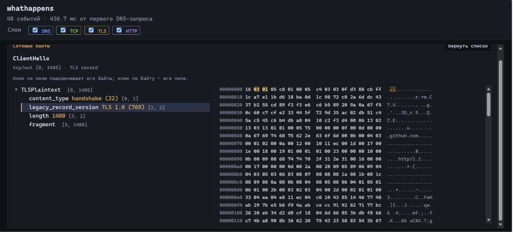
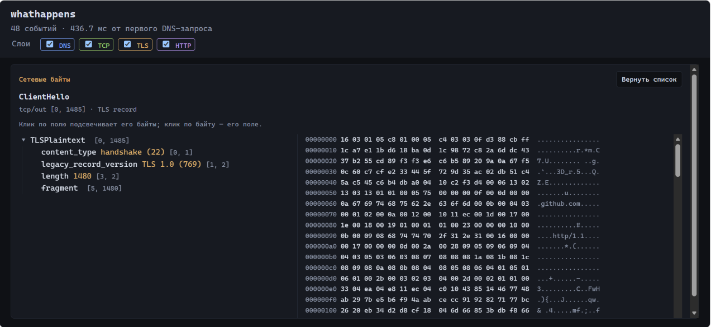
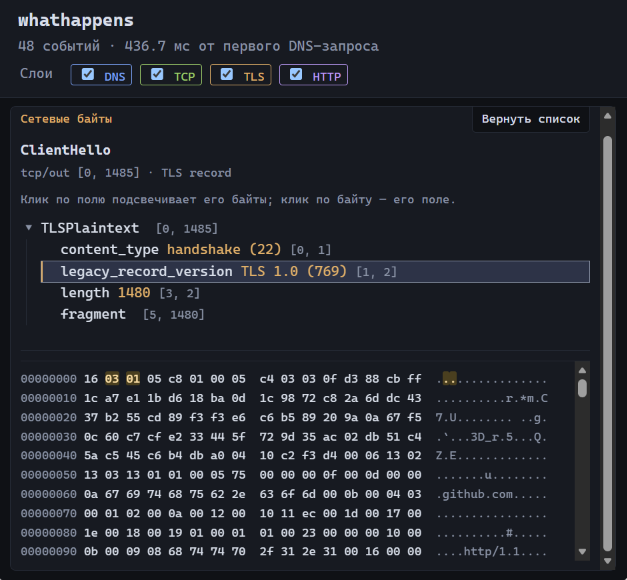

# whathappens

**Watch your own request, byte by byte.**

English | [Русский](README.ru.md)

You've read "what happens when you type google.com" a dozen times.
`whathappens` actually does it: it resolves DNS starting from the root
servers, opens the TCP connection, performs the TLS 1.3 handshake and
speaks HTTP/1.1 — then lays out *your* request as an annotated timeline
in your browser. Inspect recorded DNS and TLS bytes alongside the decrypted
handshake and HTTP contents: your DNS answers, your ClientHello with its SNI,
your server's certificate, your HTTP response. No root, no Wireshark, no telemetry.

```sh
node cli.mjs github.com/robots.txt
```



*The bundled demo trace (`npm run demo`). The page labels are in Russian for now.*

## What it does

1. **Iterative DNS with its own packets.** No `dns.lookup`: root server → `.com` →
   authoritative, on hand-built UDP datagrams (RFC 1035). Lost and malformed answers are not
   hidden — they stay in the recording.
2. **Records the TLS session.** `tls.connect` over a recording proxy stream: ciphertext in both
   directions, the session keys from Node's official `keylog` event, and the plaintext Node
   delivered.
3. **Decrypts it by itself.** TLS 1.3 per RFC 8446 (HKDF-Expand-Label, per-epoch keys, AEAD),
   independent of Node's TLS stack — only `node:crypto` primitives.
4. **Parses the fields.** ClientHello/ServerHello with extensions (SNI, ALPN, key_share,
   supported_versions…), certificates (`X509Certificate`), CertificateVerify, NewSessionTicket,
   HTTP headers and chunk sizes/data/trailers. For parsed events, every byte belongs to exactly one leaf field.
   DNS/TCP events have raw bytes without a field tree; X.509 internals are summarized, not dissected.
5. **Checks signatures independently and shows the results.** Selecting the server's
   `Certificate` or `CertificateVerify` handshake event shows our own results, each as
   *passed*, *failed* or *cannot be checked* (with the concrete reason):
   - **CertificateVerify:** the server's signature over the hash of the reconstructed transcript
     (ClientHello, ServerHello, EncryptedExtensions, Certificate), checked with the public key of
     the server's first certificate; the signature scheme must fit that key's type and curve.
   - **Certificate chain signatures:** each certificate's signature checked with the next
     certificate the server sent (issuer name must match), and the last one with a root from
     Node's built-in root store. This is **not** a full trust decision: host name, validity
     dates, certificate constraints (basicConstraints, keyUsage, name constraints), revocation
     and Certificate Transparency are not part of it.

   These are computed from the recorded bytes; they are not network events. Live connections
   are separately verified by Node itself (normal TLS certificate verification); the viewer does
   not present that as our result.
6. **Shows it all in a page.** Event timeline, hex view, field tree: click a field to highlight
   its bytes, click a byte to find its field.

   | Full width | Narrow window |
   |---|---|
   |  |  |

## HTTP bodies

Chunked transfer coding is parsed per [RFC 9112 §7.1](https://www.rfc-editor.org/rfc/rfc9112.html#section-7.1).
Gzip content is decompressed with Node's built-in zlib. Live requests advertise `Accept-Encoding: gzip`.
The original `response-body` stays available; a separate `decoded-body` event contains the
assembled/decompressed bytes with offsets starting at zero. Corrupt or incomplete bodies are
flagged and do not produce a decoded event. Decoding is limited to 4 MiB per intermediate/output
buffer and 10,000 chunk iterations; trailers remain separate from response headers.

Interim `1xx` responses before the final response (for example `103 Early Hints` or
`100 Continue`) are parsed and shown as separate `interim-response` events; they have no body.
Up to 16 interim responses are parsed; beyond that, the remaining bytes are flagged.
`101 Switching Protocols` is shown as a `protocol-switch` event marked unsupported, and the bytes
after it are not parsed as HTTP. Every response keeps absolute offsets in the received stream
(`http/in`) and is timed by the TLS record that delivered its last byte. If a later response is
truncated or malformed, the responses already parsed stay on the timeline and the remaining
bytes become one event marked "damaged"; a stream that ends before the final response gets an
empty "damaged" event that says so.

## Quick start

Requires Node.js 24+. No dependencies or install step.

```sh
git clone https://github.com/Ibra-ctrl-stak/whathappens.git
cd whathappens
```

From the project folder:

```sh
npm run demo                              # bundled trace; no external requests
node cli.mjs github.com/robots.txt         # record a chosen HTTPS target and serve its timeline
node cli.mjs "https://example.com/?q=one" --timeout 60
```

Open the printed `http://127.0.0.1:...` URL in your browser. Stop the server with Ctrl+C.
A bare hostname means HTTPS and path `/`. Paths, query strings, IDNs and custom HTTPS ports
are supported. URL fragments are not sent. Redirect responses are displayed, not followed.

Each successful live run saves `session.json` and `keylog.txt` in a new `out/run-*` directory
under the current working directory. The total DNS + TCP + TLS + HTTP deadline is 30 seconds
(`--timeout 1` through `--timeout 300`); retained wire, plaintext and keylog data share a
16 MiB byte budget. A failed live run reports an error and does not save a partial recording.

```sh
node cli.mjs --session out/run-XXXXXX/session.json   # reopen an actual saved file
node cli.mjs --help                                 # all options, including --out
npm test                                           # tests use local sockets; no external requests
```

The package remains unpublished and marked private. `npx whathappens` is not available yet.
The original `node day1.mjs [path]`, `npm run serve` and `npm run timeline` commands remain
available for the original github.com verification workflow, which uses `out/session.json`.

### Checking against Wireshark (optional)

With Wireshark installed (tshark/dumpcap): capture while `node day1.mjs` runs, then
`node compare-wireshark.mjs out/capture.pcapng` compares byte for byte the DNS packets, both TCP
streams, the handshake, and Wireshark's own decryption using our keylog. If your traffic goes
through a VPN, capture on the tunnel interface.

## TCP segments from a capture (optional)

Node only sees socket reads and writes. To see the real TCP segments of a recorded request,
capture it with Wireshark/dumpcap while it runs (on a VPN, on the tunnel interface), save as
pcapng, then open the recording with the capture:

```sh
node cli.mjs --session out/run-XXXXXX/session.json --pcap capture.pcapng
node cli.mjs --demo --pcap test/fixtures/github-robots/capture.pcapng   # bundled example
```

- **Matching:** packets between the recording's local and remote address:port, both directions.
  If several connections share that pair, one is chosen only when its client bytes match the
  recording; otherwise nothing is chosen and the reason is shown.
- **Segments:** each packet becomes a `segment` event (flags, sequence/ack relative to the first
  data byte, window, options, payload length), marked apart from socket events. Payload is tied to
  the recorded `tcp/out|in` bytes only where it matches them byte for byte; otherwise it is shown
  as "does not match the recorded stream" without bytes. SYN/ACK/FIN without payload have no bytes.
  Sequence wraparound, a capture that starts mid-connection, and overlapping ranges are handled.
- **Diagnostics are observations, not verdicts:** a gap means bytes have not appeared in the
  capture yet (not proof of loss); a range seen again is "likely a retransmission (inferred)";
  out-of-order arrival and partial overlaps are reported. These are our own heuristics and are
  not promised to match Wireshark's `tcp.analysis.*`.
- **Time:** the original capture time of every packet is kept. To place packets on the timeline,
  capture times are shifted by one constant so that the packet with the first byte of the
  ClientHello coincides with the moment Node wrote it; the packet actually leaves slightly later,
  and clock drift is not corrected. Without that packet the capture clock is used as is and the
  timeline says the time is not aligned.
- **Reader limits:** pcapng only (classic pcap is refused), up to 64 MiB, 500,000 blocks, 200,000
  packets; IPv4 + TCP over raw IP, Ethernet (incl. VLAN) or loopback; IP fragments are not
  reassembled and not used; a file cut short keeps the packets read so far. IP/TCP headers have
  no field tree yet.
- **Completeness, checked by the packets** (any capture, also `--pcap`): the file is not cut, the
  client SYN is there, every recorded byte is covered, and the connection ends with both FINs and
  the ACK of each, or an RST. What is missing is listed and the capture is called **incomplete**.
  Packets alone never make it **complete**: that also needs to know how the capture ran (see
  `capture.json` below). Without it the page says the packets show no problem, but how the capture
  was made is unknown.

### Capturing during a live request (`--capture`)

With Wireshark installed (dumpcap; Npcap on Windows), whathappens can run the capture itself:

```sh
"C:\Program Files\Wireshark\dumpcap.exe" -D          # list interfaces
node cli.mjs github.com/robots.txt --capture 7        # number or name from that list
node cli.mjs github.com/robots.txt --capture 7 --dumpcap "D:\Wireshark\dumpcap.exe"
```

- The interface is always yours to choose; it is never guessed. Through a VPN, choose the tunnel
  interface: on the physical one, the connection is inside the tunnel's encrypted packets.
- dumpcap is found as `--dumpcap <path>`, else in `PATH`, else in the standard Wireshark folder,
  and started without a shell. It starts after DNS (its filter needs the address) and before the
  TCP connection, keeps only `host <server IPv4> and tcp port <port>`, and is ready when it reports
  "Capturing on" plus a 500 ms pause: without that pause, the client SYN was missing in 3 of 5
  measured runs.
- Limits: dumpcap stops by itself after the request deadline + 7 s (`-a duration`), and the
  capture is cut at 64 MiB (the reader's limit).
- Stopping (Windows, measured): Node cannot send dumpcap a Ctrl+C, and terminating a dumpcap that
  writes its own file loses its buffered packets. So dumpcap writes pcapng to whathappens
  (`-w -`), which waits up to 2 s for both FINs (or an RST) of the connection, then stops dumpcap
  and waits for it to exit. dumpcap is stopped on success, error, timeout and Ctrl+C.
- The capture is saved as `capture.pcapng` next to `session.json` in the same `out/run-*` folder,
  with `capture.json` (format 1): what the pcapng cannot say about itself — the interface, why
  dumpcap was stopped (connection end, wait timeout, size limit, dumpcap exited by itself) and
  dumpcap's warnings — plus the size and SHA-256 of `capture.pcapng`. No dumpcap path, command
  line, process IDs or raw dumpcap output are saved.
- The capture is checked by its packets as above, and called **incomplete** also if dumpcap was
  stopped before the connection ended, reached the size limit, or stopped early. It is
  **complete** only when neither the packets nor dumpcap show anything missing. A capture that
  fails is never shown as a success; the recording is still saved.
- Reopening (`--session run/session.json --pcap run/capture.pcapng`) reads `capture.json` from the
  capture's folder and merges both levels again, so no warning is lost. It is used only if its
  size and SHA-256 match the opened file; otherwise, or if it is unreadable, it is ignored and the
  page says why. No `capture.json` (older recordings, Wireshark files) is not an error.
- Errors are explained: dumpcap not found, access denied (whathappens does not change Npcap,
  adapter, VPN or firewall settings), unknown interface, no readiness within 10 s, early exit.
- Without `--capture`, nothing of this runs and nothing beyond Node is needed.

## How it is verified

- **Wireshark as an independent oracle.** The reference session matched a capture byte for byte
  (12/12 checks); the field values in `test/fixtures/github-robots/expected.json` come from
  tshark, not from our code.
- **RFC 8448.** HKDF, traffic keys and record decryption are tested against the official
  vectors, extracted from the RFC text programmatically.
- **Damaged traffic.** Corrupted, truncated and malformed records and messages stay on the
  timeline as events marked "damaged" instead of breaking the rest.
- **Mutation checks** for key tests: a test must fail on deliberately broken code.

## Security and ethics

- The tool only sees **traffic it created itself**, and decrypts it with the keys of its own
  sessions through Node.js's official API. No interception, no circumvention.
- Live recordings (`out/`: captures, keylogs, `session.json`) are excluded by `.gitignore`.
  The one exception is the reference test session: the keys of a single public session
  (`robots.txt`), see the [fixture README](test/fixtures/github-robots/README.md).
  Local TLS tests also include deliberately public localhost-only test credentials.
  Treat your live recordings as sensitive: they contain the keys and contents of that request.
- The local page: `127.0.0.1` only, random port, a 256-bit token in the URL, `Host`/`Origin`
  checks (DNS rebinding protection), a strict CSP without inline scripts, DOM built with
  `textContent` only. The page never receives the keylog or the whole session.
- Text from the network (DNS names, HTTP headers) is escaped: control characters show up as
  `\xNN` and cannot act on the terminal or the page.

## Limitations

- TLS 1.3 only (AES-GCM, ChaCha20-Poly1305), HTTP/1.1, IPv4 and A records.
- Node cannot see the TCP layer itself. Real TCP segments come only from a pcapng capture: one
  you add with `--pcap`, or one made with `--capture` (see "TCP segments from a capture"). Without
  them, TCP events are Node socket reads/writes, not segments.
- `--capture` readiness is "Capturing on" plus a measured pause, not a guarantee; a missing SYN is
  reported. Packets dumpcap has not passed on when it is stopped (e.g. a last ACK after both FINs)
  are not in the file; the capture is then called incomplete. Checked live on Windows only.
- Not supported yet: HelloRetryRequest, KeyUpdate, TLS 1.2, Brotli/deflate, transfer-coding chains, protocol upgrades after `101`, more than one final response on a connection (pipelining), HTTP/2.
- Direct UDP/53 access to authoritative DNS servers is required for live mode; use `--demo`
  on networks that block it. HTTP-only targets and IP-literal URLs are not supported.
- Some VPN clients block `127.0.0.1` for browsers — the page will not open then.

## Layout

| Path | What is there |
|---|---|
| `cli.mjs`, `src/capture.js`, `src/target.js`, `src/viewer.js` | CLI, recording, URL validation, viewer startup |
| `src/dns/` | DNS packets and the iterative resolver |
| `src/tls/` | session recording, decryption, handshake fields, certificates and signatures |
| `src/http/` | HTTP/1.1 parsing and its fields |
| `src/pcap/` | pcapng reading, finding our connection in a capture, completeness checks, running dumpcap (`--capture`), `capture.json` |
| `src/timeline.js` | the unified event timeline `{ buffer, offset, length, fields }` |
| `src/server/`, `web/` | the local page |
| `test/` | tests, the fixture, RFC 8448 vectors |
| `tools/` | extracting the oracle from tshark and the vectors from RFC 8448 |

Progress and next steps: [PLAN.md](PLAN.md) (in Russian).

## License

[MIT](LICENSE) © 2026 Ibra-ctrl-stak.
